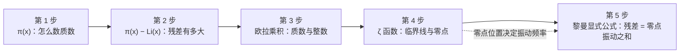
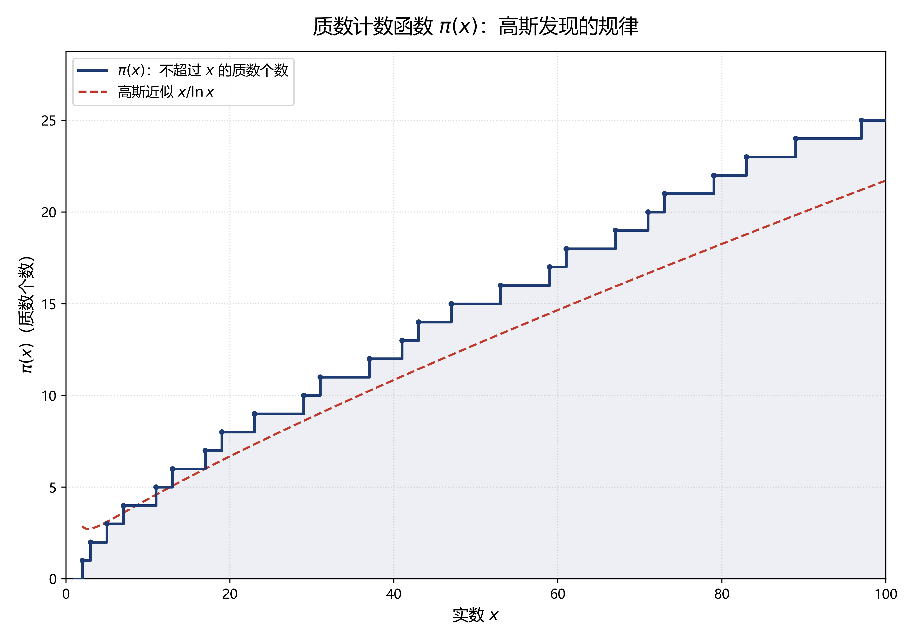
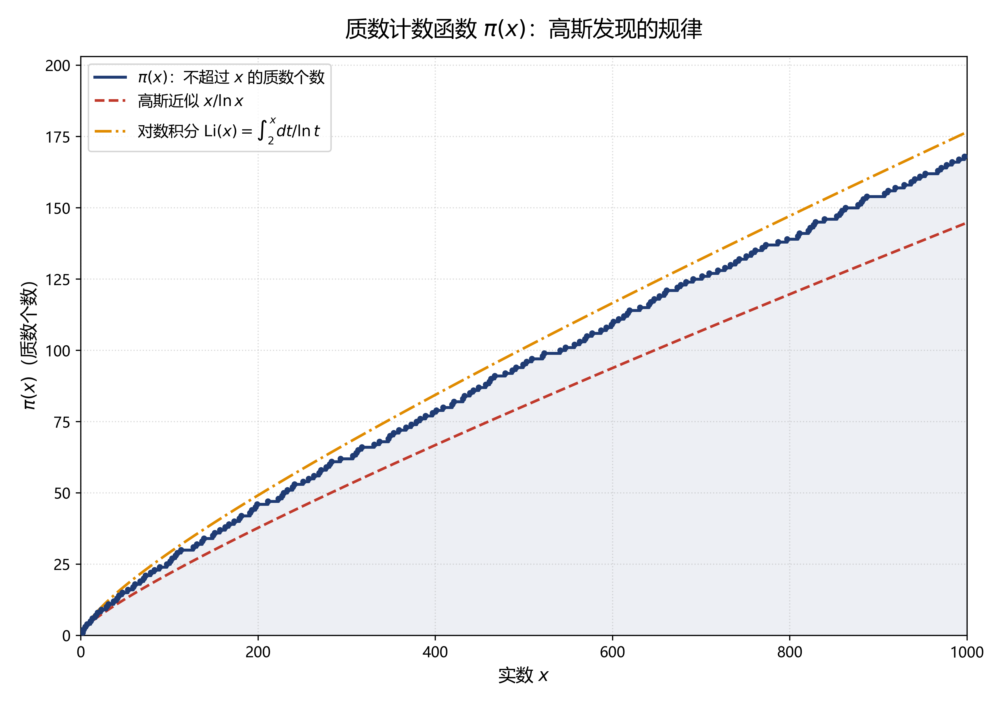
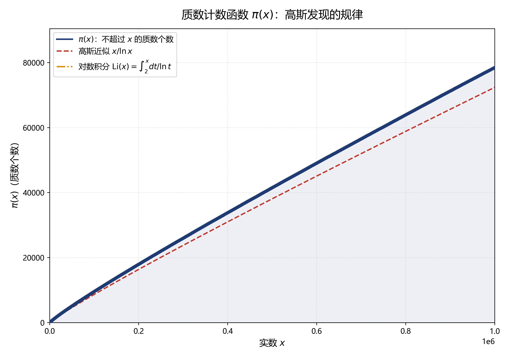
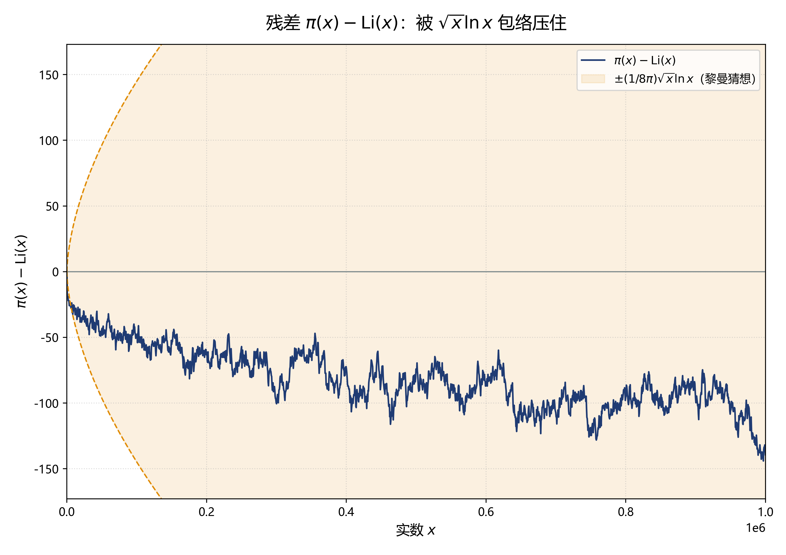
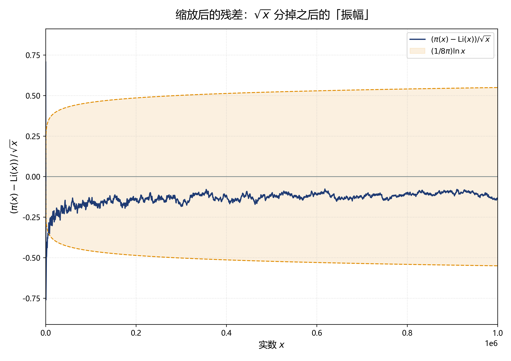
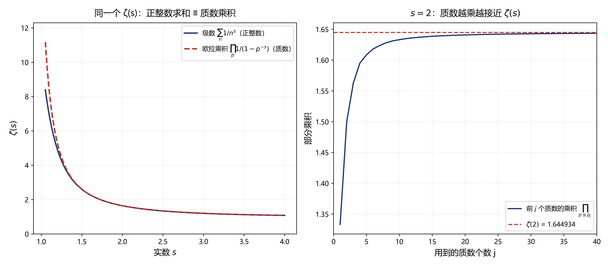
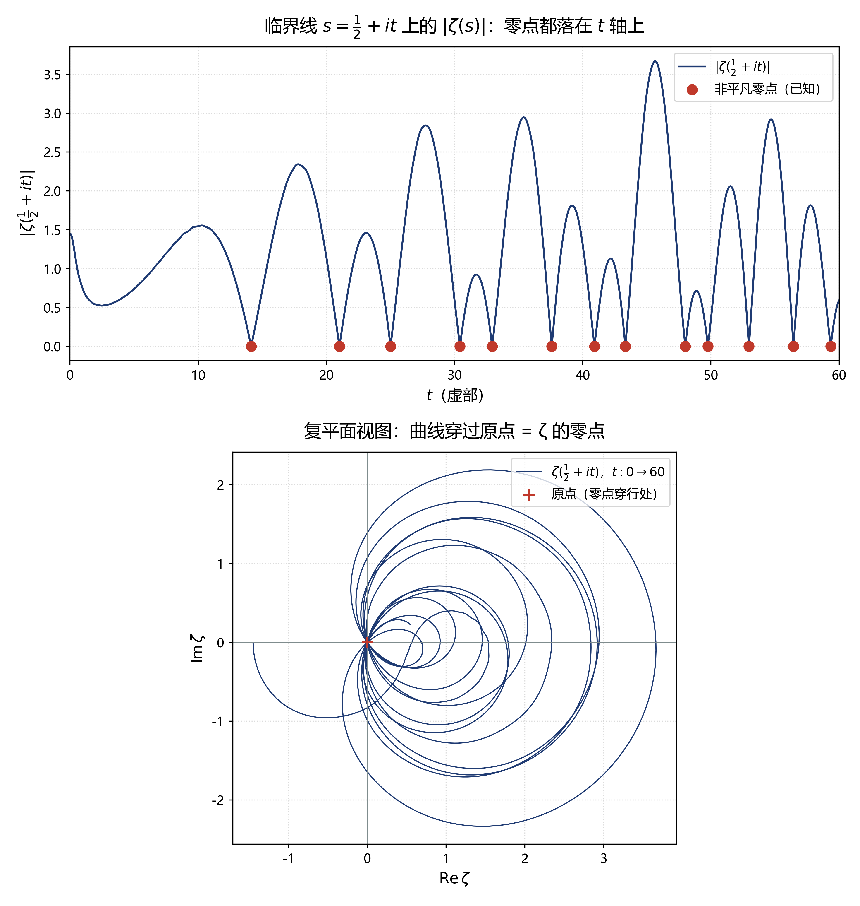
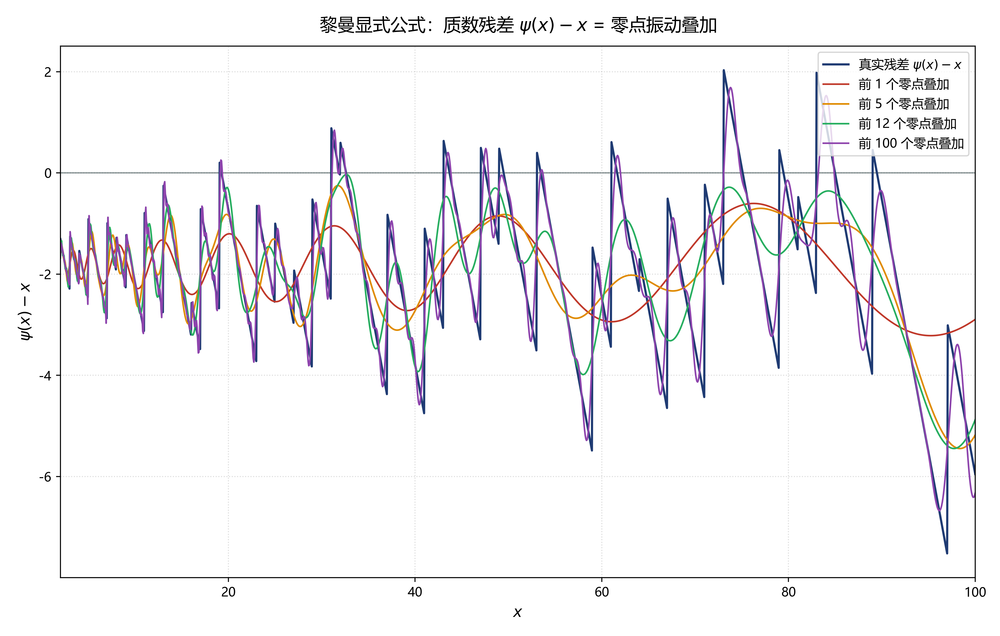

# 黎曼猜想：从数质数到零点振动

> RIEMANN HYPOTHESIS · 可视化讲解

质数是自然数里的原子，却出现得毫无规律。一百七十多年前，黎曼把「数质数」这件事翻译成一个复变函数的零点位置问题，从此奠定了现代数论的地基——而他留下的那个猜测，至今无人证明。本文用一条五步可视化主线，从 π(x) 一路走到黎曼显式公式。

| 关键事实 | 说明 |
| --- | --- |
| 1859 | 黎曼论文发表，全文仅 8 页 |
| 14.1347 | 第一个非平凡零点的虚部 |
| 10¹³ | 已被数值验证落在临界线上的零点数 |
| $1,000,000 | 千禧年大奖难题悬赏 |

---

## 结论先行

这份讲解的结论可以先放在这里：质数分布的「误差」并不是随机的噪声，它可以被精确地写成「一个主项 + 无穷多个零点振动」之和。换句话说，数质数数得准不准，取决于一个复变函数的零点排在哪里。

> **一句话结论：** 质数分布的残差可以精确写成「主项 + 无穷多个零点振动」之和；而所有非平凡零点都压在 `Re(s) = 1/2` 这条线上——这正是残差被 `√x` 量级控制住的原因，也是黎曼猜想的份量所在。

接下来的五个步骤，就是这条结论的现代版推导：先学怎么数质数，再看数不准的误差有多大，接着把质数和 ζ 函数连起来，最后让零点出场。

---

## 一段两百年的历史

黎曼猜想不是灵光一现的产物，而是三代人接力搭起来的：欧拉把质数与一个无穷级数绑在一起，高斯猜出了质数分布的整体规律，黎曼则把这个函数搬进复平面，一眼看出了隐藏的秩序。把这三个人分清楚，整条主线的设计也就顺理成章了。

### 莱昂哈德·欧拉（1707 – 1783）

**把质数写进函数的人。** 1735 年他解决了巴塞尔问题，算出 `1/1² + 1/2² + 1/3² + … = π²/6`；1737 年他又发现，这个级数可以整体改写成「对所有质数求积」的形式，即欧拉乘积。这是历史上第一次把「质数」与「函数」划上等号，还顺带给出了「质数有无穷多个」的一个全新证明。

### 卡尔·弗里德里希·高斯（1777 – 1855）

**猜出分布规律的人。** 大约十五岁时，高斯通过计算质数表发现：不超过 x 的质数个数 `π(x)`，大致等于对数积分 `Li(x) = ∫₂ˣ dt / ln t`。他没有把这条观察写成论文，直到 1863 年遗稿整理时才公之于众。而高斯本人，正是黎曼在哥廷根的老师。

### 波恩哈德·黎曼（1826 – 1866）

**把问题搬到复平面的人。** 1859 年，刚当选柏林科学院院士的黎曼提交了他唯一一篇数论论文《论小于给定数值的质数个数》，全文只有 8 页。他把 ζ 解析延拓到整个复平面、写出函数方程、给出用零点重构质数分布的显式公式，并在末尾写下那个猜测：所有非平凡零点的实部都是 `1/2`。他 39 岁死于肺结核。

> **常见误记。** ζ 函数是**欧拉**的（1737 年欧拉乘积），不是高斯；**高斯**贡献的是近似公式 `π(x) ~ x / ln x`；真正把 ζ 解析延拓到复平面、并把它与质数误差挂上钩的，才是**黎曼**。

下面是这条主线上的关键节点，从欧拉乘积一直排到今天的数值验证。

| 年份 | 事件 | 说明 |
| --- | --- | --- |
| 1737 | 欧拉乘积 | 欧拉证明 `ζ(s) = Σ 1/n^s = ∏ (1 − p^−s)^−1`，质数第一次被写进函数的语言里。 |
| 1792 – 1793 | 高斯的猜测 | 约十五岁的高斯推测 `π(x) ≈ Li(x)`；这条猜想直到 1863 年才被他身后的遗稿公开。 |
| 1852 | 切比雪夫的进展 | 切比雪夫证明了 Bertrand 公设，并说明 `π(x)` 与 `x / ln x` 始终处在同一个数量级——但还差常数是否为 1。 |
| 1859 | 黎曼的 8 页论文 | 解析延拓、函数方程、显式公式，以及「非平凡零点实部为 1/2」的猜测，全部浓缩在一篇短文中。 |
| 1896 | 素数定理 | 阿达马与德拉瓦莱普桑各自独立证明 `π(x) ~ Li(x)`；关键一步是证明 ζ 在直线 `Re(s) = 1` 上没有零点。 |
| 1900 | 希尔伯特第八问题 | 希尔伯特在世纪之交的演讲中，把黎曼猜想连同素数定理等一起列为第八问题。 |
| 1903 / 1953 | 计算机出现之前与之后 | Gram 用手算验证了前 15 个零点；Turing 在 1953 年给出可机器执行的严格校验方法，让「验证零点」变成可规模化的计算。 |
| 1914 | 哈代定理 | 哈代证明了临界线上存在**无穷多个**非平凡零点——这是第一次证明「临界线上的零点确实不少」。 |
| 1972 | 与随机矩阵的意外联系 | 蒙哥马利与戴森发现：零点的间距统计与随机厄米矩阵特征值的分布（GUE）一致，暗示零点或许来自某个量子力学算子（希尔伯特–波利亚猜想）。 |
| 2000 | 千禧年大奖难题 | 克雷数学研究所把黎曼猜想列为七个千禧年难题之一，悬赏一百万美元。 |
| 2004 / 2021 | 数值验证的边界 | 2004 年，前 `10¹³` 个非平凡零点被逐一验证落在临界线上；2021 年，Platt 与 Trudgian 把「确认无零点」的范围推进到高度 `3 × 10¹²`。 |

> **为什么它这么难？** 黎曼在那篇论文里提出了不止一个猜测，后来大部分都被陆续证明了，唯独「零点是否都排在临界线上」这一条至今悬而未决。它不是孤立的一道题：数论里成百上千条命题都是「假定黎曼猜想成立」才被证明的。

---

## 主线地图

五步之间不是并列关系，而是一条有明确因果链的推导路径。



> **主线一句话：** 数质数 → 看误差 → 找到生成函数 → 定位零点 → 用零点精确重构误差。

---

## 第 1 步：怎么数质数 π(x)

与其逐个判断「这个数是不是质数」，更有价值的问题是问总量：**不超过 x 的质数一共有多少个**，记作 `π(x)`。它是一个只会在质数处往上跳一级的阶梯函数。脚本用埃氏筛生成质数表，再累加出这条阶梯。

有两条光滑曲线试图逼近这条阶梯：高斯近似 `x / ln x`，以及对数积分 `Li(x) = ∫₂ˣ dt / ln t`。两者都给出了正确的「密度趋势」，但 `Li(x)` 明显更贴近阶梯——这也是后面所有讨论都以它作为基准的原因。

| x ≤ 100 | x ≤ 1000 | x ≤ 10⁶ |
| --- | --- | --- |
|  |  |  |
| 阶梯是 π(x)，虚线为高斯近似与 Li(x)。 | π(1000) = 168，阶梯与包络的差距很小。 | π(10⁶) = 78498，Li(10⁶) ≈ 78637.4。 |

*图：质数计数函数与两条光滑近似（脚本 step1_prime_counting.py，dpi = 400）。*

---

## 第 2 步：残差有多大

既然 `Li(x)` 这么准，那把两者相减会得到什么？答案是：**残差不趋于零**，而是一直在 0 附近来回振荡。真正被控制住的不是残差本身，而是它的**量级**。

这一步引入 von Koch 定理作为标尺：若黎曼猜想成立，则对足够大的 x 有

```
|π(x) − Li(x)|  ≤  (1 / 8π) · √x · ln x        (x ≥ 2657)
```

也就是说，残差最多以 `√x · ln x` 的速度增长，而 `Li(x)` 本身以 `x / ln x` 的速度增长——两者相除，相对误差趋于零。这张「包络」正是黎曼猜想在质数计数上的直接推论。



**残差 π(x) − Li(x)**：红色包络为 ±(1/8π)·√x·ln x，残差始终被压在它内部。



**缩放后的残差 (π(x) − Li(x)) / √x**：用 √x 分掉增长趋势后，剩下的是稳定振荡的振幅，包络相应变为 (1/8π)·ln x。

---

## 第 3 步：欧拉乘积——连接正整数与质数

质数凭什么能被一个函数「编码」？靠的就是上一节提到的那条 1737 年的公式：把左边对所有正整数求和，右边对所有质数求积，两边完全相等。左边只用到加法，右边只用到乘法与质数，这条等式就是「质数的信息藏在 ζ 里」的入口。

```
ζ(s) = Σ_{n≥1} 1 / n^s  =  ∏_{p 为质数} 1 / (1 − p^−s)
```

脚本用「部分乘积」与「级数部分和」做对照：取的质数越多，右侧的乘积就越逼近左侧的和，两者收敛到同一个 `ζ(s)`。下面取 `s = 2` 演示这一收敛过程（其极限正是欧拉解决的巴塞尔问题：π²/6 ≈ 1.6449）。



**部分乘积 vs 级数部分和**：随参与质数增多，欧拉乘积逐级逼近 ζ(s)，与级数求和收敛到同一值。

---

## 第 4 步：ζ 函数、临界线与零点

上面的级数只有在 `Re(s) > 1` 时才收敛，可我们要讨论零点的位置，就必须让 ζ 在整个复平面上都有定义——这正是黎曼 1859 年做的第一件事。脚本按实部自动路由到三种表示，完成解析延拓：

- **Re(s) > 1**：直接用定义级数 `Σ 1/n^s`（绝对收敛）。
- **0 < Re(s) ≤ 1**：用狄利克雷 η 延拓 `ζ(s) = η(s) / (1 − 2^(1−s))`，其中 η 是交替级数。
- **Re(s) ≤ 0**：用函数方程延拓 `ζ(s) = 2^s · π^(s−1) · sin(πs/2) · Γ(1−s) · ζ(1−s)`。

延拓之后，零点分成两类：`s = −2, −4, −6, …` 这些是**平凡零点**；其余全部落在 `0 ≤ Re(s) ≤ 1` 的临界带里，称为**非平凡零点**，第一个位于 `s = 1/2 + 14.1347i` 附近。下图沿临界线 `Re(s) = 1/2` 扫描 `|ζ(1/2 + it)|`，每一次曲线触到零轴，就是一个非平凡零点。



**临界线上的 |ζ(1/2 + it)|**：上图为模值随 t 的曲线，下图把同一段曲线画在复平面上，穿过原点处即为零点。

只看一条线还不够直观。把 |ζ(s)| 铺成三维曲面，可以一眼看到**极点**在 `s = 1` 处竖起一根尖峰，而零点则表现为曲面「触底」的点。为了让左半平面的指数级增长与零点附近的细节出现在同一张图里，纵轴改用对数高度 `log10(1 + |ζ(s)|)`：零点处高度恰为 0，起伏细节保持可见。

下面的三维曲面是可交互页面：曲面按 rainbow 色表着色，实部 −4 ~ 6、虚部 **0 ~ 100**（覆盖更多非平凡零点），临界面 `Re(s) = 1/2` 用透明红色网格标出，并对每个非平凡零点画了指向它的箭头。**拖拽旋转、滚轮缩放。**

> 交互式三维曲面：[zeta-3d-interactive.html](zeta-3d-interactive.html)
>
> *图：log10(1 + |ζ(s)|) 交互式曲面（rainbow 配色），由 `step4_zeta_critical_line.py --html` 导出。*

> **为什么曲面左半边像「一堵墙」？** 由函数方程可推出，当 `Re(s) = σ → −∞` 时 `|ζ(s)| ~ |τ|^(1/2) · (2π / |τ|)^σ`（τ 为虚部）。关键阈值是 `2π ≈ 6.28`：当 `|Im(s)| > 2π` 时，越往左 `|ζ|` 越大；而 `|Im(s)| < 2π` 时越往左越接近 0。数值上：`ζ(−4 + 5i) ≈ 0.57`、`ζ(−4 + 20i) ≈ 191`、`ζ(−4 + 40i) ≈ 4091`。这正是对数纵轴存在的理由。

---

## 第 5 步：黎曼显式公式

最后一步，把前面所有线索缝在一起。为了得到更干净的等式，这里改用切比雪夫第二函数 `ψ(x) = Σ_{p^k ≤ x} ln p`（对质数及其幂次加权求和）。黎曼显式公式给出的是一段**精确的恒等式**，而不是近似：

```
ψ(x) = x  −  Σ_ρ x^ρ / ρ  −  ln(2π)  −  ½ · ln(1 − x^−2)
```

其中求和 `Σ_ρ` 遍历 ζ 的**所有非平凡零点** `ρ = 1/2 + iγ`。主项 `x` 给出整体趋势，后面的零点项则贡献出一层层振动——质数分布的「抖动」就是这些振动的叠加。由于零点成共轭对出现，每一对可以合并成一个实振动：

```
x^ρ / ρ + x^ρ̄ / ρ̄  =  2√x · [ (1/2)·cos(γ ln x) + γ·sin(γ ln x) ] / (1/4 + γ²)
```

于是「残差 = 主项 + 无穷多个零点振动」不再是一个比喻，而是一个可以逐项累加的公式：零点加得越多，重构出的阶梯就越贴合真实数据。下图用前 1 / 5 / 12 / 100 个零点做叠加，可以清楚看到叠加项越多、曲线越贴近真实残差。



**残差 ψ(x) − x 的零点展开**：深蓝为真实残差，其余曲线为前 1 / 5 / 12 / 100 个零点的叠加结果。

下面把综合图做成可交互版本：拖动滑动条改变参与叠加的零点个数 **N（1 ~ 100）**，上图为真实 `ψ(x)/ln x` 阶梯与前 N 个零点重构的对比，下图为真实残差 `ψ(x)−x` 与前 N 个零点振动叠加的对比。**N 越大，重构曲线越贴合真实数据。**

> 交互式综合图（滑动条调节叠加项数 N）：[step5-summary-interactive.html](step5-summary-interactive.html)
>
> *图：ψ(x)/ln x 与残差 ψ(x)−x 的零点展开（可交互，滑动条调节叠加项数 N），由 `step5_riemann_explicit_formula.py --html` 导出。*

---

## 数值自检

每个脚本都带一组数值校核，用来确认实现没有写错。下表是全部通过的结果，也是判断「公式确实能被算出来」的直接证据。

| 检查项 | 计算结果 | 说明 |
| --- | --- | --- |
| π(100) | 25 | 质数计数基准值 |
| π(1000) | 168 | 质数计数基准值 |
| π(10⁶) | 78498 | 质数计数基准值 |
| Li(10⁶) | 78637.4 | 对数积分近似，高于真实 π(10⁶) |
| ζ(0) | −0.5 | 函数方程延拓结果 |
| ζ(−1) | −0.083308 | 左半平面取负值 |
| ζ(−2) / ζ(−4) | ≈ 0 | 平凡零点 |
| ζ(3) | 1.20206 | Apéry 常数，级数收敛验证 |
| ζ(1/2 + 14.1347i) | ≈ 0.00149 | 第一个非平凡零点附近 |
| ψ(10) | 7.832 | 切比雪夫第二函数 |
| ψ(100) | 94.045 | 切比雪夫第二函数 |
| 前 100 零点叠加 ψ(x) − x @ x = 100 | ≈ −6.33 | 真实残差为 −5.955，有限项下仍在振荡逼近 |
| 前 100 零点重构 ψ(x)/ln x @ x = 100 | 20.340 | 真实值 20.422 |

*数值来自各 step 脚本内置的自检输出。*

---

## 局限与说明

- **条件收敛。** 显式公式中的零点求和是条件收敛的，有限项叠加**不会单调逼近**真值，而是围绕真值不断振荡、逐步收紧。因此「加更多零点就更准」应理解为整体趋势，而不是逐项单调改善。
- **零点来源。** 脚本内使用的前 100 个非平凡零点虚部由 `mpmath.zetazero` 离线生成后硬编码（实部均取 1/2），运行时不依赖 mpmath 求值，因此运行更快也更容易复现。
- **图像口径。** 所有图片由 matplotlib 的 Agg 后端生成，纯白背景、dpi = 400，适合打印。三维图与临界线图都由脚本内部实现 ζ 的求值，不调用现成的特殊函数库求 ζ。
- **本文范围。** 这是一份讲解性质的入口，展示的是黎曼猜想在质数分布上的推论与可视化证据，不构成猜想的证明。

## 对应脚本

本文所有图与数值都来自下面五个脚本，均位于上一级目录：

- [step1_prime_counting.py](../step1_prime_counting.py) — 质数计数 π(x) 阶梯图 + 高斯近似 / 对数积分
- [step2_prime_counting_error.py](../step2_prime_counting_error.py) — π(x) − Li(x) 残差与 von Koch 包络
- [step3_euler_product.py](../step3_euler_product.py) — 欧拉乘积公式：正整数求和 ↔ 质数乘积
- [step4_zeta_critical_line.py](../step4_zeta_critical_line.py) — ζ 的解析延拓、临界线零点与 |ζ| 曲面（2D + 3D + 交互）
- [step5_riemann_explicit_formula.py](../step5_riemann_explicit_formula.py) — 黎曼显式公式：残差 = 零点振动叠加
